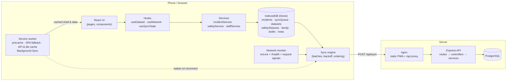
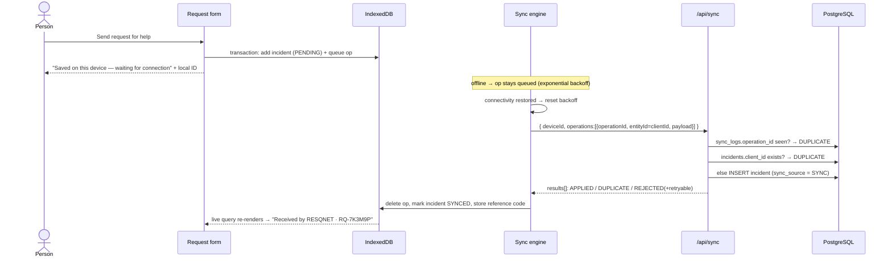
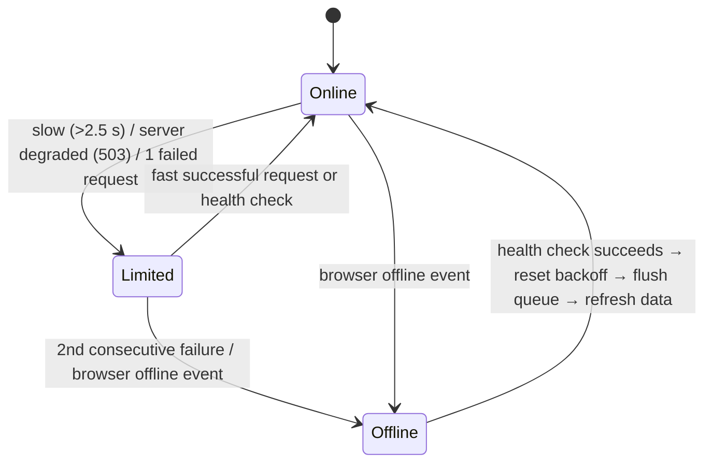

# RESQNET architecture

RESQNET is an **offline-first** PWA. Every user action is written to the device first and delivered to the
server when a connection exists. The network is an optimisation, not a requirement.

## System overview

### Layers

| Layer | Frontend | Backend |
|---|---|---|
| Presentation | `pages/`, `components/`, `layouts` (`components/layout`) | `routes/` (URL → middleware chain) |
| Coordination | `hooks/` (reactive reads of IndexedDB and stores) | `controllers/` (HTTP in/out only) |
| Domain logic | `services/`, `offline/`, `sync/` | `services/` (business rules, idempotency, audit) |
| Persistence | `database/db.ts` (Dexie / IndexedDB) | `models/prisma.ts` + Prisma → PostgreSQL |
| Shared | `@resqnet/shared`: enums, Zod schemas, labels, priority rules, status workflow, bundled guides/contacts |

The `shared` package means a request is validated by **the same Zod schema** in the browser (for instant
feedback, even offline) and on the server (authoritative).

## Offline request lifecycle

### Duplicate prevention (idempotency)

1. Every queued operation has a stable `operationId`; `sync_logs.operation_id` is **UNIQUE**, so a replayed
   operation is applied once.
2. Every entity has a device-generated `clientId`; `incidents.client_id` and `user_safety_status.client_id`
   are **UNIQUE**, so even a *different* operation that recreates the same entity (two tabs, the service
   worker racing the page, a direct POST plus a queued replay) resolves to the original row.
3. Concurrent inserts that race past the existence check hit the unique constraint (Prisma `P2002`) and are
   resolved to the existing row.
4. A Web Lock (`navigator.locks`) stops two tabs or the service worker from flushing at the same time.

### Queue rules

| Rule | Why |
|---|---|
| Oldest first, batches of ≤ 25, ≤ 8 batches per flush | Fair, bounded requests on poor links |
| Backoff 5 s · 2ⁿ, capped at 5 min, with jitter | Doesn't drain battery or hammer a recovering server |
| Backoff reset when connectivity returns | Requests go out immediately on reconnect |
| A later op for an entity waits for earlier ones | A `CANCEL` can never overtake its `CREATE` |
| `REJECTED` + `retryable:false` → `FAILED`, shown to the user | Invalid data is surfaced, not retried forever |
| `SYNCING` ops older than 2 min are retried | Recovers from a tab closed mid-request |

## Connectivity model

`navigator.onLine` alone is never trusted: it only says a network interface exists. The monitor polls
`GET /api/health` (every 30 s online, 8 s when degraded, paused when the tab is hidden), and every API call
reports success/latency or failure. A demo-only switch can force OFFLINE for presentations.

## What is cached where

| Data | Storage | Available offline | Freshness shown |
|---|---|---|---|
| App shell (HTML, JS, CSS, icons) | Service-worker precache | Always after first visit | — |
| Emergency contacts, safety guides | **Bundled in the JS** + IndexedDB copy from server | Always, even first launch | "Built into the app" or last sync time |
| Shelters, alerts, disaster types | IndexedDB (`datasets`, one region pack) | After a download | "Last synchronised HH:MM (n minutes ago)" |
| My reports, safety status, sync queue | IndexedDB | Always | Per-item delivery badge |
| Family members, my emergency info | IndexedDB only — **never uploaded** | Always | — |
| Last known GPS position | IndexedDB (`meta.lastKnownLocation`) | Always | Age shown; sent with source `SAVED` and a note |
| Public API GET responses | SW runtime cache (network-first, 5 s timeout) | Second safety net | — |
| Map tiles viewed online | SW cache (cache-first, 600 tiles, 14 days) | Previously viewed areas only | Map shows a warning offline |

Expired alerts are filtered on every read, so a cached alert is never shown after its expiry time.

## Security architecture

- **Passwords**: Argon2id (m = 19 MiB, t = 2, p = 1), transparent re-hash on login when parameters change;
  login timing equalised for unknown emails.
- **Sessions**: 15-minute HS256 access JWT held **in memory only**; opaque refresh token in an `HttpOnly`,
  `SameSite=Strict`, `Path=/api/auth` cookie, stored server-side as a hash, rotated on every use, with
  token-family revocation on reuse.
- **CSRF**: only `/auth/refresh` and `/auth/logout` use cookies; they require `X-Requested-With: resqnet`
  and an allow-listed `Origin`.
- **Authorisation**: role checked on every request from the **database** (30 s cache), not from the token,
  so demotions and deactivation apply immediately. Route guards in the UI are convenience only.
- **Data minimisation**: volunteers see ~1 km location and no phone number until they accept a task;
  reporters can only look up their own reports by `clientId` + device/user ownership; analytics never
  expose coordinates.
- **Input**: Zod validation on every body/query/param; unknown keys stripped; 100 kB body limit; Prisma
  parameterised queries (raw SQL only via tagged templates).
- **Headers**: Helmet (`default-src 'none'` on the API), strict CSP on the PWA (nginx), CORS allow-list.
- **Abuse**: rate limits — 600/min per IP overall, 20 per 15 min for login/register, 120 per 10 min per
  device+IP for emergency writes (keyed by device so many people behind one carrier NAT are not blocked).
- **Audit**: logins, failed logins, token reuse, every incident/alert/shelter/contact/user change and all
  demo actions are written to `audit_logs`.
- **Errors**: users only ever see friendly messages; stack traces and SQL stay in server logs (pino, with
  credentials and phone numbers redacted).

## Extension points

| Future capability | Where it plugs in |
|---|---|
| AI incident prioritisation | `PriorityAdvisor` interface in `shared/src/priority.ts` — swap `ruleBasedPriorityAdvisor`; output is stored as *advisory* score + reasons and never changes status/assignment |
| SMS gateway / LoRa / mesh / satellite | A new `SyncTransport` implementation (`frontend/src/sync/engine.ts`) — the queue, idempotency keys and `/api/sync` contract stay the same |
| Government / weather / IoT sensor feeds | A backend job that calls `alertService.createAlert` |
| Intelligent resource allocation | A service reading incidents + shelters, writing *suggestions* to `incident_updates` |
