# RESQNET database design

PostgreSQL 14+ via Prisma. Source of truth: [`prisma/schema.prisma`](../prisma/schema.prisma);
migrations in [`prisma/migrations`](../prisma/migrations).

## Entity–relationship diagram

```mermaid
erDiagram
  users ||--o{ refresh_sessions : "has"
  users ||--o| responders : "profile"
  users ||--o| volunteers : "profile"
  users ||--o{ incidents : "reports (reporter_id)"
  users ||--o{ incidents : "handles (assigned_responder_id)"
  users ||--o{ incidents : "supports (assigned_volunteer_id)"
  users ||--o{ incident_updates : "writes"
  users ||--o{ user_safety_status : "sets"
  users ||--o{ alerts : "publishes"
  users ||--o{ audit_logs : "acts"
  users ||--o{ sync_logs : "syncs"
  incidents ||--o{ incident_updates : "timeline"
  disaster_types ||--o{ alerts : "categorises"
  disaster_types ||--o{ safety_guides : "categorises"
  shelters ||--o{ shelter_resources : "stocks"

  users {
    uuid id PK
    varchar email UK
    varchar name
    varchar phone
    text password_hash "argon2id"
    enum role "CIVILIAN|VOLUNTEER|RESPONDER|ADMIN"
    bool is_active
  }
  refresh_sessions {
    uuid id PK
    uuid user_id FK
    char64 token_hash UK "sha256"
    uuid family_id "rotation family"
    timestamptz expires_at
    timestamptz revoked_at
  }
  incidents {
    uuid id PK
    uuid client_id UK "device idempotency key"
    varchar reference_code UK "RQ-XXXXXX"
    uuid reporter_id FK
    uuid device_id
    enum type
    enum severity
    enum people_count
    text_arr special_requirements
    float latitude
    float longitude
    varchar location_text
    enum status
    int priority_score "advisory 0-100"
    uuid assigned_responder_id FK
    uuid assigned_volunteer_id FK
    timestamptz client_created_at "pressed send"
    timestamptz created_at "server receipt"
    varchar sync_source "DIRECT|SYNC"
    bool is_demo
  }
  incident_updates {
    uuid id PK
    uuid incident_id FK
    uuid author_id FK
    enum status
    varchar note
  }
  shelters {
    uuid id PK
    varchar name
    varchar region
    float latitude
    float longitude
    int capacity
    int occupancy
    text_arr facilities
    enum status "OPEN|FULL|CLOSED"
  }
  shelter_resources {
    uuid id PK
    uuid shelter_id FK
    varchar resource_type
    int quantity
  }
  alerts {
    uuid id PK
    uuid disaster_type_id FK
    enum severity "INFO|ADVISORY|WARNING|CRITICAL"
    varchar region
    timestamptz starts_at
    timestamptz expires_at
    bool is_active
    bool is_demo
  }
  disaster_types {
    uuid id PK
    varchar code UK
    varchar name
  }
  safety_guides {
    uuid id PK
    varchar slug UK
    uuid disaster_type_id FK
    jsonb sections
  }
  emergency_contacts {
    uuid id PK
    varchar name
    enum service
    varchar phone
    varchar region "NULL = national"
  }
  user_safety_status {
    uuid id PK
    uuid client_id UK
    uuid user_id FK
    uuid device_id
    enum status "SAFE|NEED_ASSISTANCE|EMERGENCY|UNKNOWN"
  }
  sync_logs {
    uuid id PK
    uuid operation_id UK "replay protection"
    uuid device_id
    enum entity_type
    enum result "APPLIED|DUPLICATE|REJECTED"
  }
  audit_logs {
    uuid id PK
    uuid actor_id FK
    varchar action
    varchar entity_type
    jsonb metadata
  }
  responders {
    uuid id PK
    uuid user_id FK,UK
    varchar agency
  }
  volunteers {
    uuid id PK
    uuid user_id FK,UK
    text_arr skills
  }
```

## Design notes

**Keys.** UUID primary keys everywhere; entities that can be created on a device carry an additional
`client_id` UUID (UNIQUE) generated on the device. That column is the idempotency key that makes offline
replay safe. `reference_code` is a short human code (no look-alike characters) that can be read aloud on
a phone call.

**Roles.** Implemented as a PostgreSQL enum on `users.role` rather than a `roles` table: the four roles
are fixed by the specification and the enum enforces validity at the database level. Role-specific
attributes live in `responders` / `volunteers` (1:1 with users).

**Two timestamps on incidents.** `client_created_at` is when the person pressed *send* (possibly hours
earlier, offline); `created_at` is when the server received it. Both matter for triage. Device clocks
are clamped server-side (never in the future, never > 30 days old). `sync_source` records whether the
report arrived directly or through the offline queue.

**Referential actions.** Deleting a user nulls their references (`SET NULL`) so incident history survives;
deleting an incident cascades to its timeline; disaster types are `RESTRICT`ed while alerts/guides use them.
Shelters, contacts, alerts and guides are soft-deleted (`is_active` / `is_published`) to preserve history.

**CHECK constraints** (hand-written in the initial migration, since Prisma can't express them):

| Table | Constraint |
|---|---|
| shelters | `capacity > 0`, `occupancy >= 0`, latitude/longitude in range |
| shelter_resources | `quantity >= 0` |
| incidents | coordinates in range, **paired** (both or neither), **has a location** (coordinates or text), `priority_score` 0–100, `sync_source` ∈ {DIRECT, SYNC} |
| alerts | `expires_at > starts_at` |
| user_safety_status | owned by a user **or** a device |

**Indexes** support the hot paths: incident queue (`status, severity`), recency (`created_at`), ownership
look-ups (`device_id`, `reporter_id`), assignment (`assigned_*_id`), active alerts (`is_active, expires_at`),
region filters, audit queries (`entity_type, entity_id`), and per-device sync history.

**Demo data** is flagged with `is_demo` on alerts and incidents. Analytics exclude it by default and
`POST /api/demo/reset` deletes only flagged rows.

**Privacy.** Family members and personal medical notes are deliberately **not** in this schema — they
stay on the user's device.
